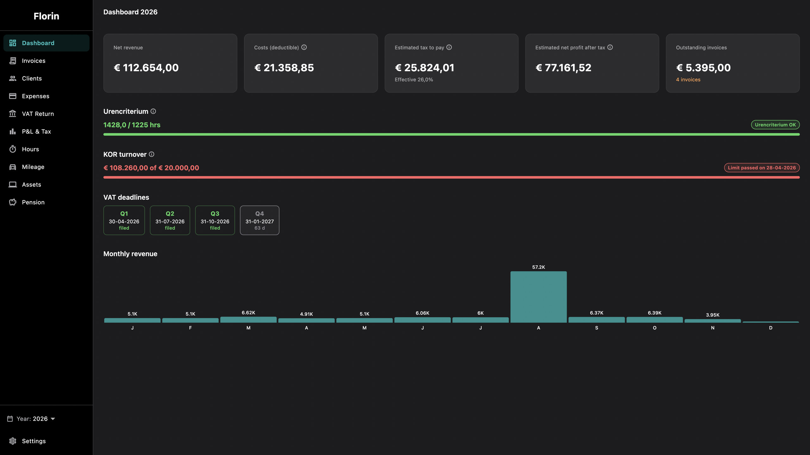

<div align="center">


# Florin

**Bookkeeping for Dutch freelancers (ZZP). Free, offline, and on your own computer.**

[](https://github.com/RashadAnsari/florin/actions/workflows/build.yml)
[](https://github.com/RashadAnsari/florin/releases/latest)
[](LICENSE)
[](#install)
[](docs/tax-years/2026.md)
[](#)

English | [Nederlands](README.nl.md)

[**Download for macOS, Windows or Linux**](https://github.com/RashadAnsari/florin/releases/latest)



</div>

Florin keeps your invoices, expenses, BTW returns, hours, mileage, assets and pension room in one desktop app, and shows what you will owe the Belastingdienst as you go. No subscription, no account, no cloud: your records are one file on your own computer.

## Why Florin

- **Built on Dutch tax law, with the sources.** Every rate, threshold and invoice rule in Florin is checked against the statute on wetten.overheid.nl or the Belastingdienst, and the quote and link are in [`docs/legal.md`](docs/legal.md) and [`docs/tax-years/`](docs/tax-years/).
- **Know your numbers all year.** The dashboard shows revenue, costs, BTW to pay and an estimate of your income tax as you add invoices and expenses, including wages from a job next to your business. Every estimate is marked as one.
- **Explained as you go.** Every field and every tax term has a short explanation one hover away.
- **Invoices built from the BTW rules.** PDF invoices include the items listed in article 35a of the Wet op de omzetbelasting, with btw verlegd, intra-Community supplies, services outside the EU and credit notes that name the invoice they correct.
- **Your data stays yours.** One local database file, `florin.db`, with your receipts in a folder next to it, in a folder you choose. Keep that folder in iCloud Drive, OneDrive or Dropbox for backup, or copy it somewhere safe while Florin is closed. Settings copies the database and receipts to another folder, and choosing a folder that already holds `florin.db` on first start opens it. Florin never connects to the internet: the fonts are built in.
- **Ready for your returns and your accountant.** Export a full year to CSV files in one click, into a new folder named after the export date: every record, the BTW return of each quarter by rubriek in whole euros as the form asks, the ICP list of each quarter, the estimated income tax, the facts it rests on (business details, pension, yearly tax inputs and which returns you filed and paid) and your receipts. Florin prepares the figures; you file them in Mijn Belastingdienst Zakelijk, or your accountant does.
- **Free and open source** under the MIT license.

## Features

| | |
|---|---|
| **Invoicing** | Dutch PDF invoices with automatic numbering. Dutch BTW, btw verlegd to Dutch and EU businesses, intra-Community supplies of goods, export outside the EU and services to businesses outside the EU, with the treatment checked against the client's country. Sell through a merchant of record such as an app store or reseller: mark it as one and record the invoices it issues to you (self-billing). Issued invoices are locked; corrections are credit notes. Status from draft to paid, including overdue. |
| **Receipts** | Add the PDF, photo, scan or e-invoice of each expense and asset by dropping it in. Florin copies it as it is into a receipts folder next to your database, shows how long to keep it, checks that nothing went missing, and keeps the PDF of every invoice you issue exactly as you sent it. Florin never deletes a receipt: one you remove stays under Removed receipts. Exports include all of them. |
| **Expenses** | Costs by category with BTW reclaim, business use percentage and receipt tracking, including purchases where the BTW is shifted to you. Food, drinks and representation use whichever of the 80% rule and the € 5.700 threshold deducts more, and BTW on restaurant meals is not reclaimed. Fines, ordinary clothing, personal care, a phone line at home and general literature are recorded but not deducted, and travel and stay for courses and congresses counts up to € 1.500 a year. |
| **BTW return** | Each quarter pre-filled from your records: rubrieken 1a, 1b, 1d, 1e, 2a, 3a, 3b, 4a, 4b, 5a and 5b, plus the supplies for the ICP-opgaaf. Filing and payment tracked per quarter, with the deadline shown. |
| **Kleineondernemersregeling** | Enter when your KOR started and Florin follows it: KOR invoices without BTW, no BTW reclaimed on purchases, no regular return for quarters the KOR covers, an incidental return when BTW is shifted to you, and your turnover against the € 20.000 limit. Without the KOR, Florin expects a return every quarter, a nil return included. The invoice that passes the limit carries BTW again and Florin ends the KOR from there. |
| **Income tax estimate** | For a business owner under the AOW age, with or without a job next to the business. Wages from your jaaropgaaf are taxed together with your profit, the loonheffing already withheld is subtracted, and the loon Zvw lowers the Zvw contribution on your profit. Zelfstandigenaftrek, startersaftrek, S&O-aftrek, meewerkaftrek, stakingsaftrek, startersaftrek bij arbeidsongeschiktheid, mkb-winstvrijstelling, KIA, EIA, MIA, desinvesteringsbijtelling, herinvesteringsreserve, depreciation, gains on sold assets, lijfrente, disability insurance, losses from earlier years, algemene heffingskorting, arbeidskorting and the Zvw contribution. The estimated belastbare winst, box 1 income and tax to pay are shown together for when you ask for or change a voorlopige aanslag or estimate your income for toeslagen, with the last day to do so. A fiscal partner, other work, benefits, box 2 and box 3 are not included; [`docs/legal.md`](docs/legal.md) lists what Florin does not model. |
| **Urencriterium** | Hours per client and project, with progress towards the 1,225 hours you need for the zelfstandigenaftrek. With a job, Florin also checks that you spend more hours on the business than in employment, unless you were not a business owner in one or more of the five previous years. |
| **Mileage** | Business and commuting trips with odometer readings and purpose, deducted at the Belastingdienst rate for the year. |
| **Fixed assets** | Straight-line depreciation by day down to the residual value, business use percentage, KIA, EIA, MIA and the herinvesteringsreserve. The BTW on the purchase and on a sale goes into your BTW return, and BTW you cannot reclaim, such as under the KOR, counts as part of the cost. |
| **Business car** | The private-use addition (bijtelling) with the zero-emission reduction and the 500 km rule, and the BTW on private use in the last return of the year. |
| **Pension** | Your jaarruimte from last year's profit and wages, AOW-franchise and factor A, plus reserveringsruimte, and premiums for disability insurance (AOV). |
| **Clients** | Contact details, BTW and KvK numbers, and the Wet DBA risk per client. Mark a private person as one: Florin then offers only the treatments that fit, and warns when supplies with Dutch BTW to private persons in other EU countries pass the € 10.000 threshold above which electronic services are taxed in their country. |

Florin covers the **2026** tax year. Only covered years can be selected and booked into; a new year arrives in an update once its figures are published and checked.

## Install

Download the file for your system from the [latest release](https://github.com/RashadAnsari/florin/releases/latest).

### macOS

With [Homebrew](https://brew.sh):

```sh
brew tap rashadansari/florin https://github.com/RashadAnsari/florin
brew trust --cask rashadansari/florin/florin
brew install --cask florin
```

Or manually:

1. Unzip `florin-macos.zip`
2. Move `Florin.app` to your Applications folder
3. Open `Florin.app`

Florin is signed and notarized by Apple. Requires macOS 12 or later.

### Windows

1. Download and run `florin-windows-x64-setup.exe`
2. If Windows SmartScreen appears, click **More info**, then **Run anyway**
3. Follow the installer. Florin is added to the Start menu and can be removed from **Settings > Apps** like any other app.

For a portable version without installing, unzip `florin-windows-x64.zip` and run `florin.exe`.

### Linux

On Ubuntu, Debian, Linux Mint and other Debian-based systems, download `florin-linux-amd64.deb` and open it to install. Florin then appears in your app menu.

On other distributions, extract `florin-linux-x64.tar.gz` to a folder and run `./florin`.

## Build from source

Florin is a Flutter app. Install the Flutter version listed under `environment.flutter` in `pubspec.yaml`, then run:

```sh
git clone https://github.com/RashadAnsari/florin.git
cd florin
flutter pub get
flutter run -d macos   # or windows / linux
```

To try Florin with a fictional business, run `make demo` and choose the new `demo` folder when Florin first starts.

Before committing, run `make local`. It regenerates translations and database code, formats, analyzes and runs the tests. [`AGENTS.md`](AGENTS.md) describes how the project is organised.

### Releasing

One workflow, `.github/workflows/build.yml`, lints, tests and builds every push and pull request. To release, raise `version` in `pubspec.yaml` to the next `MAJOR.MINOR.PATCH` (for example `1.2.0`, without a build number) and push it to `master`. After the checks and builds pass, the workflow packages macOS, Windows and Linux, tags the commit as `v1.2.0`, publishes the GitHub release and updates the Homebrew cask. Pushes whose version already has a release only lint, test and build.

## Disclaimer

Florin is free, open-source software provided as is, without any warranty. It helps you keep your financial records and is not a substitute for professional tax or legal advice.

Every figure and rule in Florin was checked against the law and the Belastingdienst, and the sources are published with the code. Even so, the calculations are estimates. They can contain errors, can fall behind changes in the law, and may not fit your situation. Check your tax obligations with an accountant (boekhouder) or tax adviser before filing with the Belastingdienst.

The authors accept no liability for errors in calculations, missed deadlines, incorrect filings, financial loss or any other consequence of using this software. Use Florin at your own risk.

## License

[MIT](LICENSE)
