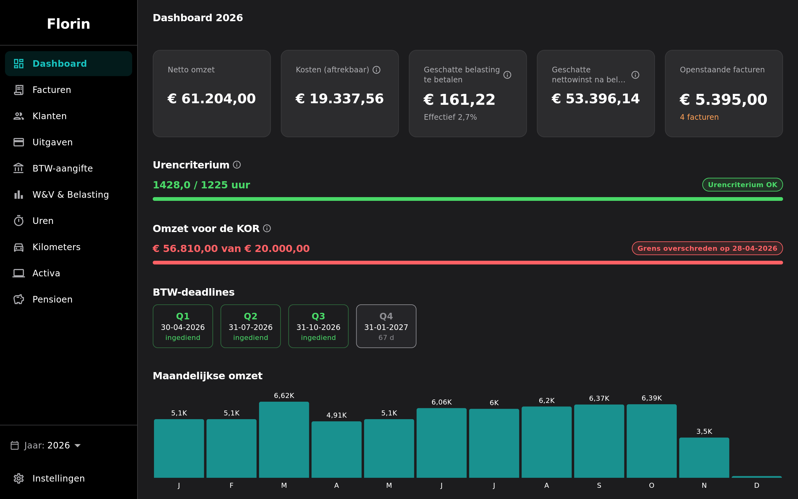

<div align="center">


# Florin

**Boekhouding voor zzp'ers. Gratis, offline en op je eigen computer.**

[](https://github.com/RashadAnsari/florin/actions/workflows/build.yml)
[](https://github.com/RashadAnsari/florin/releases/latest)
[](LICENSE)
[](#installeren)
[](docs/tax-years/2026.md)
[](#)

[English](README.md) | Nederlands

[**Download voor macOS, Windows of Linux**](https://github.com/RashadAnsari/florin/releases/latest)



</div>

Florin houdt je facturen, uitgaven, btw-aangiftes, uren, kilometers, bedrijfsmiddelen en pensioenruimte bij in één desktop-app, en schat gaandeweg wat je aan de Belastingdienst gaat betalen. Geen abonnement, geen account, geen cloud: je administratie is één databasebestand en een map met bonnen op je eigen computer.

## Waarom Florin

- **Gebouwd op de Nederlandse belastingwet, met bronnen.** Elk tarief, elke drempel en elke factuurregel in Florin komt met de wettekst of Belastingdienst-tekst waarop hij berust, geciteerd en gelinkt in [`docs/legal.md`](docs/legal.md) en [`docs/tax-years/`](docs/tax-years/).
- **Het hele jaar inzicht in je cijfers.** Het dashboard toont omzet, kosten, te betalen btw en een schatting van je inkomstenbelasting terwijl je facturen en uitgaven invoert, ook met loon uit een baan naast je onderneming. Elke schatting staat als schatting aangegeven.
- **Uitleg waar je hem nodig hebt.** Elk veld en elk fiscaal begrip heeft een korte uitleg onder de muisaanwijzer.
- **Facturen opgebouwd volgens de btw-regels.** Pdf-facturen bevatten de vermeldingen die de wet op een factuur vraagt voor de behandelingen die Florin biedt, met btw verlegd, intracommunautaire leveringen, diensten buiten de EU en creditnota's die de gecorrigeerde factuur noemen.
- **Jouw gegevens blijven van jou.** Eén lokaal databasebestand, `florin.db`, met je bonnen in een map ernaast, in een map die je zelf kiest. Zet die map in iCloud Drive, OneDrive of Dropbox als back-up, of kopieer hem naar een veilige plek terwijl Florin gesloten is. Via Instellingen kopieer je de database en bonnen naar een andere map, en kies je bij de eerste start een map waarin al `florin.db` staat, dan opent Florin die. Florin maakt nooit verbinding met internet: de lettertypen zitten in de app.
- **Klaar voor je aangiftes en je boekhouder.** Exporteer een volledig jaar met één klik naar CSV-bestanden, in een nieuwe map met de exportdatum in de naam: alle gegevens, de btw-aangifte van elk tijdvak per rubriek in hele euro's zoals het formulier vraagt, het ICP-overzicht van elk ICP-tijdvak, een kwartaal of de maanden die goederen maandelijks maken, de geschatte inkomstenbelasting, de geschatte balans met de vermogensvergelijking van de aangifte, de gegevens waar die op rust (bedrijfsgegevens, pensioen, fiscale gegevens van het jaar en welke aangiftes je hebt gedaan en betaald) en je bonnen. Florin zet de cijfers klaar; je dient ze zelf in via Mijn Belastingdienst Zakelijk, of je boekhouder doet dat.
- **Gratis en open source** onder de MIT-licentie.

## Functies

De [handleiding](docs/guide.nl.md) loopt langs elke taak, van de eerste factuur tot de jaarafsluiting.


| | |
|---|---|
| **Facturen** | Nederlandse pdf-facturen met automatische nummering. Nederlandse btw, btw verlegd naar Nederlandse en EU-ondernemers, intracommunautaire leveringen van goederen, uitvoer buiten de EU en diensten belast buiten de EU, voor ondernemers en particulieren daar, met de btw-behandeling getoetst aan het land van de klant. Verkoop via een merchant of record, zoals een app store of wederverkoper: markeer die als zodanig en leg de facturen vast die hij aan jou uitreikt (self-billing). Verzonden facturen liggen vast; correcties gaan met een creditnota. Status van concept tot betaald, inclusief verlopen facturen, met het totaal dat openstaat en verlopen is. Een factuur is verlopen vanaf de dag na de vervaldatum en zegt dan wat de wet je geeft: rente en minstens € 40 incassokosten bij een bedrijf, vanaf de dag na de afgesproken betaaldag of, als er geen is afgesproken, vanaf 30 dagen nadat het de factuur ontving; eerst een aanmaning bij een particulier; en de laatste dag waarop de vordering naar de rechter kan. |
| **Bonnen** | Voeg de pdf, foto, scan of e-factuur van elke uitgave en elk bedrijfsmiddel toe door hem erin te slepen. Florin kopieert hem ongewijzigd naar een map met bonnen naast je database, toont hoe lang je hem bewaart, controleert of er niets ontbreekt en bewaart de pdf van elke factuur die je uitreikt precies zoals je hem verstuurde. Florin verwijdert nooit een bon: een bon die je weghaalt blijft onder Verwijderde bonnen. Exports bevatten ze allemaal. |
| **Uitgaven** | Kosten per categorie met btw-teruggave, zakelijk gebruikspercentage en bonnetjesregistratie, ook voor aankopen waarbij de btw naar jou is verlegd. Voor voedsel, drank en representatie neemt Florin wat het meest aftrekt: de 80%-regeling of de drempel van € 5.700. Btw op restaurantmaaltijden wordt niet teruggevraagd. Relatiegeschenken met btw worden per ontvanger opgeteld, en de btw erop wordt niet teruggevraagd zodra de geschenken aan een ontvanger in een jaar boven € 227 komen. Boetes, gewone kleding, persoonlijke verzorging, een telefoonaansluiting thuis en algemene literatuur worden vastgelegd maar niet afgetrokken, en reizen en verblijf voor cursussen en congressen tellen mee tot € 1.500 per jaar, binnen de 80%-regeling voor voedsel, drank en representatie. |
| **Btw-aangifte** | Elk tijdvak vooraf ingevuld vanuit je administratie, per kwartaal, per maand of per jaar zoals de Belastingdienst met je afsprak: rubrieken 1a, 1b, 1d, 1e, 2a, 3a, 3b, 4a, 4b, 5a en 5b, plus de prestaties voor de ICP-opgaaf. Aangifte en betaling per tijdvak bijgehouden, met de deadline erbij. Florin bewaart wat je aangaf: een latere wijziging tot € 1.000 gaat mee in je volgende aangifte van hetzelfde jaar, een grotere wordt gemarkeerd voor een suppletie. Florin waarschuwt als een jaar niet meer voldoet aan de voorwaarden voor een jaaraangifte, en toont elke opgaaf ICP met een eigen tijdvak en uiterste datum, ook als goederen aan EU-ondernemers die maandelijks maken. |
| **Kleineondernemersregeling** | Vul in wanneer je KOR begon en Florin volgt hem: KOR-facturen zonder btw, geen btw terugvragen op inkopen, geen gewone aangifte voor tijdvakken die de KOR dekt, een incidentele aangifte als er btw naar je is verlegd, en je omzet tegenover de grens van € 20.000. Zolang je meedoet aan de KOR, schat Florin de btw die je terugbetaalt op bedrijfsmiddelen waarop je btw aftrok (herziening) en telt die op bij de laatste aangifte van het jaar, of bij een bedrijfsmiddel dat je onder de KOR verkoopt bij de aangifte over dat tijdvak. Zonder KOR verwacht Florin elk tijdvak een aangifte, ook een nihilaangifte. De factuur die de grens overschrijdt is weer belast met btw en Florin beëindigt de KOR vanaf daar; hij geldt weer vanaf een nieuwe begindatum die je invult. |
| **Schatting inkomstenbelasting** | Voor een ondernemer onder de AOW-leeftijd, met of zonder baan naast de onderneming. Loon van je jaaropgaaf wordt samen met je winst belast, de al ingehouden loonheffing gaat eraf en het loon Zvw verlaagt de Zvw-bijdrage over je winst. Zelfstandigenaftrek, startersaftrek, S&O-aftrek, meewerkaftrek, stakingsaftrek, startersaftrek bij arbeidsongeschiktheid, mkb-winstvrijstelling, KIA, EIA, MIA, desinvesteringsbijtelling, herinvesteringsreserve, afschrijvingen, winst op verkochte bedrijfsmiddelen, lijfrente, arbeidsongeschiktheidsverzekering, verliezen uit eerdere jaren, algemene heffingskorting, arbeidskorting en de Zvw-bijdrage. De balans op 31 december en de vermogensvergelijking die de aangifte vraagt (vraag 19), uit je administratie plus je banksaldo, leningen en privéonttrekkingen en -stortingen. De geschatte belastbare winst, het verzamelinkomen in box 1 en de te betalen belasting staan bij elkaar voor als je een voorlopige aanslag aanvraagt of wijzigt of je inkomen voor toeslagen schat, met de laatste dag waarop dat kan. Een fiscale partner, overig werk, uitkeringen, box 2 en box 3 tellen niet mee; [`docs/legal.md`](docs/legal.md) noemt wat Florin niet berekent. |
| **Urencriterium** | Uren per klant en project, gekoppeld aan je klanten, en de uren van je fiscale partner per dag voor de meewerkaftrek, apart van je eigen uren, met je voortgang naar de 1.225 uur die je nodig hebt voor de zelfstandigenaftrek. Florin controleert ook dat je meer uren aan de onderneming besteedt dan in loondienst en ander werk, tenzij je in een of meer van de vijf voorgaande jaren geen ondernemer was. |
| **Kilometers** | Zakelijke ritten en woon-werkritten met kilometerstanden en doel, afgetrokken tegen het tarief van de Belastingdienst voor dat jaar. |
| **Bedrijfsmiddelen** | Lineaire afschrijving per dag tot de restwaarde, hoogstens het jaarlijkse maximale deel van de kosten, zakelijk gebruikspercentage, KIA, EIA, MIA en de herinvesteringsreserve. De btw op de aankoop en op een verkoop komt in je btw-aangifte, en btw die je niet terugvraagt, zoals onder de KOR, telt mee als kosten. |
| **Auto van de zaak** | De bijtelling voor privégebruik, met het hogere percentage voor auto's die in 2016 of eerder voor het eerst zijn toegelaten, de korting voor emissievrije auto's en de 500 km-regel over al je auto's samen, waarbij Florin de rittenregistratie controleert op gaten in de kilometerstanden en ontbrekende routes voordat het erop vertrouwt, en de btw over privégebruik in de laatste aangifte van het jaar. |
| **Pensioen** | Je jaarruimte op basis van de winst en het loon van vorig jaar, AOW-franchise en factor A of pensioenpremies, plus reserveringsruimte, en premies voor een arbeidsongeschiktheidsverzekering (AOV) zoals je ze betaalt. |
| **Klanten** | Contactgegevens, btw- en KvK-nummer en je eigen Wet DBA-inschatting per klant, met de uren die je ervoor vastlegde, wat je factureerde en het geschatte uurtarief dat daaruit volgt. Markeer een particulier als particulier: Florin biedt dan alleen de btw-behandelingen die passen, en waarschuwt als prestaties met Nederlandse btw aan particulieren in andere EU-landen de drempel van € 10.000 passeren waarboven telecommunicatie-, omroep- en elektronische diensten en afstandsverkopen van goederen in hun land belast zijn. |

Florin dekt het belastingjaar **2026**. Alleen gedekte jaren zijn te kiezen en te boeken; een nieuw jaar komt in een update zodra de bedragen zijn gepubliceerd en gecontroleerd.

## Installeren

Download het bestand voor jouw systeem bij de [nieuwste versie](https://github.com/RashadAnsari/florin/releases/latest).

### macOS

Met [Homebrew](https://brew.sh):

```sh
brew tap rashadansari/florin https://github.com/RashadAnsari/florin
brew trust --cask rashadansari/florin/florin
brew install --cask florin
```

Of handmatig:

1. Pak `florin-macos.zip` uit
2. Zet `Florin.app` in je map Apps
3. Open `Florin.app`

Florin is ondertekend en genotariseerd door Apple. Vereist macOS 12 of nieuwer.

### Windows

1. Download en start `florin-windows-x64-setup.exe`
2. Verschijnt Windows SmartScreen, klik dan op **Meer informatie** en daarna op **Toch uitvoeren**
3. Volg de installatie. Florin komt in het Startmenu en is te verwijderen via **Instellingen > Apps**, net als andere apps.

Wil je Florin gebruiken zonder te installeren, pak dan `florin-windows-x64.zip` uit en start `florin.exe`.

### Linux

Op Ubuntu, Debian, Linux Mint en andere Debian-gebaseerde systemen download je `florin-linux-amd64.deb` en open je het bestand om te installeren. Florin verschijnt daarna in je appmenu.

Op andere distributies pak je `florin-linux-x64.tar.gz` uit in een map en start je `./florin`.

## Zelf bouwen

Florin is een Flutter-app. Installeer de Flutter-versie die onder `environment.flutter` in `pubspec.yaml` staat en voer dan uit:

```sh
git clone https://github.com/RashadAnsari/florin.git
cd florin
flutter pub get
flutter run -d macos   # of windows / linux
```

Wil je Florin uitproberen met een verzonnen onderneming? Voer `make demo` uit en kies bij de eerste start de nieuwe map `demo`.

Voer vóór elke commit `make local` uit. Dat genereert vertalingen en databasecode opnieuw, formatteert, analyseert en draait de tests. [`AGENTS.md`](AGENTS.md) beschrijft hoe het project is opgebouwd.

### Een versie uitbrengen

Eén workflow, `.github/workflows/build.yml`, lint, test en bouwt elke push en pull request. Verhoog voor een nieuwe versie `version` in `pubspec.yaml` naar de volgende `MAJOR.MINOR.PATCH` (bijvoorbeeld `1.2.0`, zonder buildnummer) en push naar `master`. Als de controles en builds slagen, maakt de workflow pakketten voor macOS, Windows en Linux, tagt de commit als `v1.2.0`, publiceert de GitHub-release en werkt de Homebrew-cask bij. Pushes waarvan de versie al een release heeft, worden alleen gelint, getest en gebouwd.

## Disclaimer

Florin is gratis open-source software, geleverd zoals hij is, zonder enige garantie. Het helpt je je financiële administratie bij te houden. Het geeft geen fiscaal of juridisch advies.

Alle bedragen en regels in Florin zijn gecontroleerd in de wet en bij de Belastingdienst, en de bronnen zijn met de code gepubliceerd. Toch zijn de berekeningen schattingen. Ze kunnen fouten bevatten, achterlopen op wetswijzigingen en niet passen bij jouw situatie.

De makers zijn niet aansprakelijk voor fouten in berekeningen, gemiste deadlines, onjuiste aangiftes, financieel verlies of andere gevolgen van het gebruik van deze software. Gebruik Florin op eigen risico.

## Licentie

[MIT](LICENSE)
