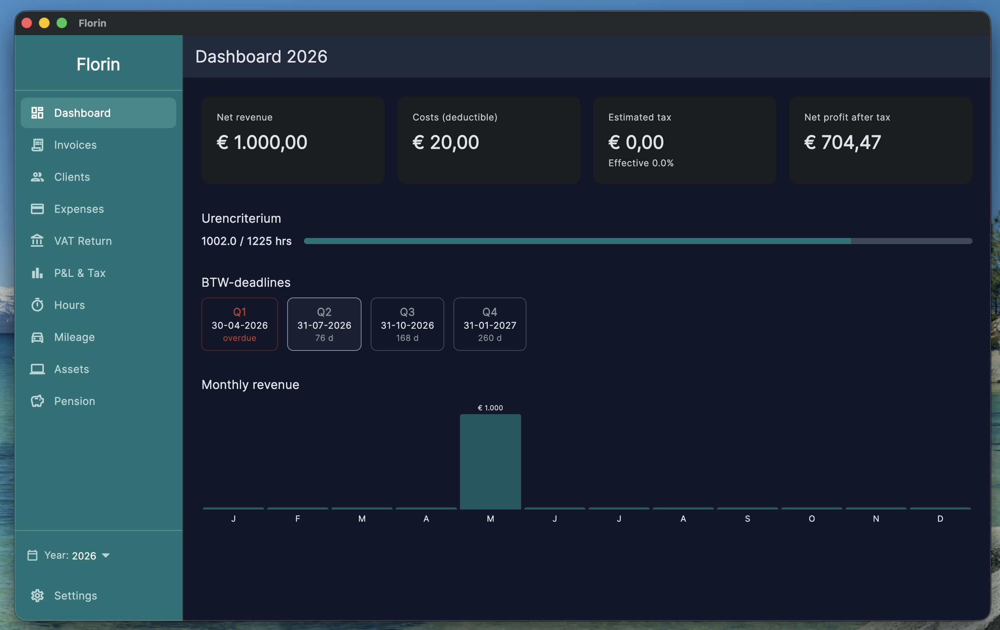

# Florin

[English](README.md) | Nederlands

**Boekhouding voor zzp'ers. Gratis, offline en op je eigen computer.**

Florin houdt je facturen, uitgaven, btw-aangiftes, uren, kilometers, bedrijfsmiddelen en pensioenruimte bij in één desktop-app, en laat gaandeweg zien wat je aan de Belastingdienst gaat betalen. Geen abonnement, geen account, geen cloud: je administratie is één bestand op je eigen computer.

Beschikbaar voor macOS, Windows en Linux, in het Nederlands en Engels.



[**Download de nieuwste versie**](../../releases/latest)

---

## Waarom Florin

- **Gemaakt voor de Nederlandse zzp-regels.** Zelfstandigenaftrek, startersaftrek, MKB-winstvrijstelling, KIA, urencriterium en de btw-kwartalen zitten er standaard in. Fiscale begrippen worden in de app kort uitgelegd.
- **Het hele jaar inzicht in je cijfers.** Het dashboard toont omzet, kosten, te betalen btw en een schatting van je inkomstenbelasting terwijl je facturen en uitgaven invoert. Zo kom je bij de jaaraangifte niet voor verrassingen te staan.
- **Jouw gegevens blijven van jou.** Alles staat in één lokaal databasebestand. Je kiest zelf de map, dus je kunt die in een gesynchroniseerde map zoals iCloud Drive, OneDrive of Dropbox zetten als back-up.
- **Klaar voor je boekhouder.** Exporteer een volledig jaar met één klik naar CSV-bestanden: facturen, factuurregels, uitgaven, uren, kilometers, bedrijfsmiddelen en klanten.
- **Gratis en open source** onder de MIT-licentie.

## Functies

| | |
|---|---|
| **Facturen** | Pdf-facturen in het Nederlands met automatische nummering. Creditnota's, ICP (intracommunautaire prestaties) en btw verlegd. Status van concept tot betaald, inclusief verlopen facturen. |
| **Uitgaven** | Kosten per categorie met btw-teruggave, zakelijk gebruikspercentage voor gemengde kosten en bonnetjesregistratie. |
| **Btw-aangifte** | Kwartaalaangifte vooraf ingevuld vanuit je facturen en uitgaven: rubrieken 1a, 1b, 1c, 3a, 5a en 5b. Houd per kwartaal aangifte en betaling bij, met de aangiftedeadline erbij. |
| **Winst en belasting** | Schatting van je inkomstenbelasting met zelfstandigenaftrek, startersaftrek, MKB-winstvrijstelling, KIA / EIA / MIA, afschrijvingen, lijfrente, algemene heffingskorting en arbeidskorting. |
| **Urencriterium** | Uren per klant en project, met je voortgang naar de 1.225 uur per jaar die je nodig hebt voor de zelfstandigenaftrek. |
| **Kilometers** | Zakelijke ritten met kilometerstanden en doel, en de aftrekbare vergoeding van € 0,23 per km. |
| **Bedrijfsmiddelen** | Lineaire afschrijving, zakelijk gebruikspercentage en KIA / EIA / MIA, direct verwerkt in je belastingschatting. |
| **Pensioen (jaarruimte)** | Je jaarruimte met AOW-franchise, factor A en onbenutte ruimte uit eerdere jaren. |
| **Klanten** | Contactgegevens, btw- en KVK-nummer en het Wet DBA-risico per klant. |

## Installeren

Download het bestand voor jouw systeem bij de [nieuwste versie](../../releases/latest).

### macOS

Met [Homebrew](https://brew.sh):

```sh
brew tap rashadansari/florin https://github.com/RashadAnsari/florin
brew trust --cask rashadansari/florin/florin
brew install --cask florin
```

Of handmatig:

1. Pak `florin-macos.zip` uit
2. Zet `Florin.app` in je map Apps
3. Open `Florin.app`

Florin is ondertekend en genotariseerd door Apple. Vereist macOS 10.15 of nieuwer.

### Windows

1. Download en start `florin-windows-x64-setup.exe`
2. Verschijnt Windows SmartScreen, klik dan op **Meer informatie** en daarna op **Toch uitvoeren**
3. Volg de installatie. Florin komt in het Startmenu en is te verwijderen via **Instellingen > Apps**, net als andere apps.

Wil je Florin gebruiken zonder te installeren, pak dan `florin-windows-x64.zip` uit en start `florin.exe`.

### Linux

Op Ubuntu, Debian, Linux Mint en andere Debian-gebaseerde systemen download je `florin-linux-amd64.deb` en open je het bestand om te installeren. Florin verschijnt daarna in je appmenu.

Op andere distributies pak je `florin-linux-x64.tar.gz` uit in een map en start je `./florin`.

## Veelgestelde vragen

**Waar worden mijn gegevens opgeslagen?**
In één bestand, `florin.db`. Je kiest de map bij de eerste start van Florin en kunt die later verplaatsen via Instellingen.

**Hoe maak ik een back-up?**
Zet de databasemap in een gesynchroniseerde map of een map waarvan een back-up wordt gemaakt, of kopieer `florin.db` naar een veilige plek. Sluit Florin voordat je het bestand kopieert.

**Kan Florin mijn btw-aangifte of inkomstenbelasting indienen?**
Nee. Florin zet de cijfers klaar; je dient ze zelf in via Mijn Belastingdienst Zakelijk, of je boekhouder doet dat.

**Heeft Florin een internetverbinding nodig?**
Nee. Florin uploadt je gegevens nooit. Als je online bent, downloadt de app zijn lettertypen van Google Fonts; offline gebruikt hij standaardlettertypen en werkt alles gewoon.

## Disclaimer

Florin helpt je je financiële administratie bij te houden. Het is geen vervanging voor professioneel fiscaal of juridisch advies.

De berekeningen, aftrekposten en bedragen in Florin zijn schattingen op basis van openbare Nederlandse belastingregels. Ze kunnen onvolledig, verouderd of niet van toepassing op jouw situatie zijn. Laat je belastingverplichtingen altijd controleren door een boekhouder of belastingadviseur voordat je aangifte doet bij de Belastingdienst.

De maker is niet aansprakelijk voor fouten in berekeningen, gemiste deadlines, onjuiste aangiftes, financieel verlies of andere gevolgen van het gebruik van deze software. Gebruik Florin op eigen risico.

## Licentie

[MIT](LICENSE)

Wil je Florin zelf bouwen of meewerken? Zie [Build from source](README.md#build-from-source) in de Engelse README.
